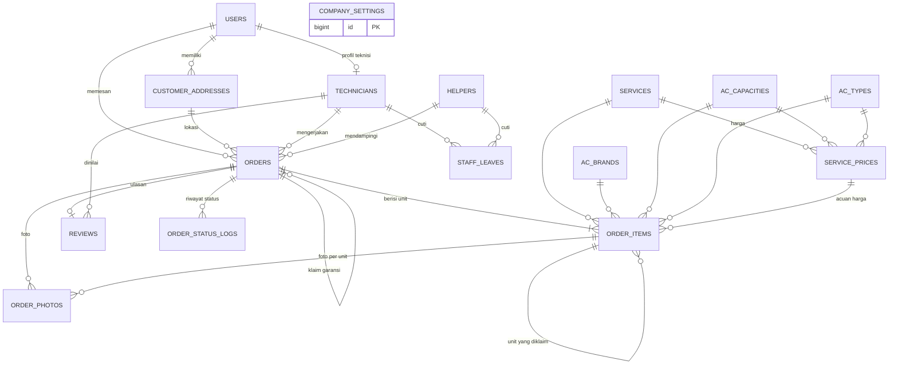
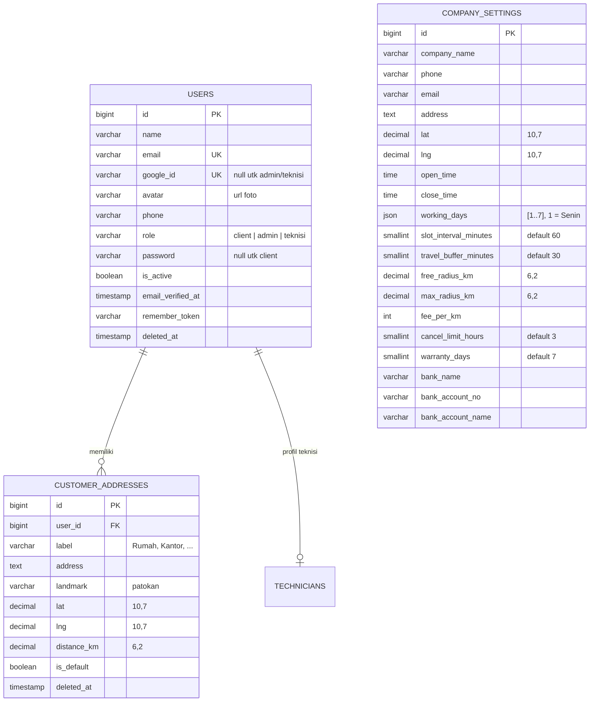
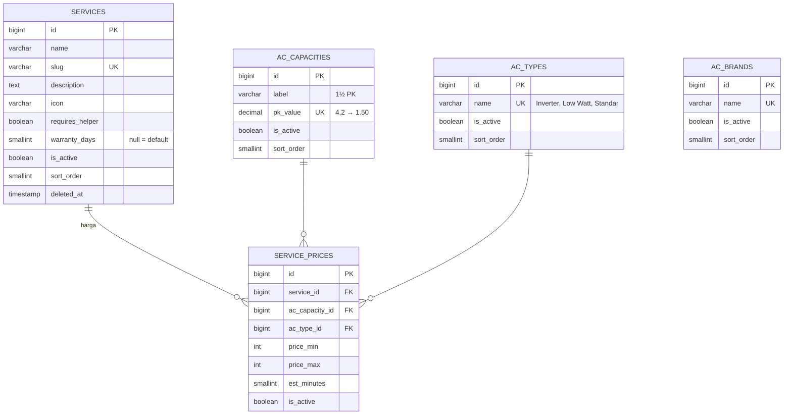
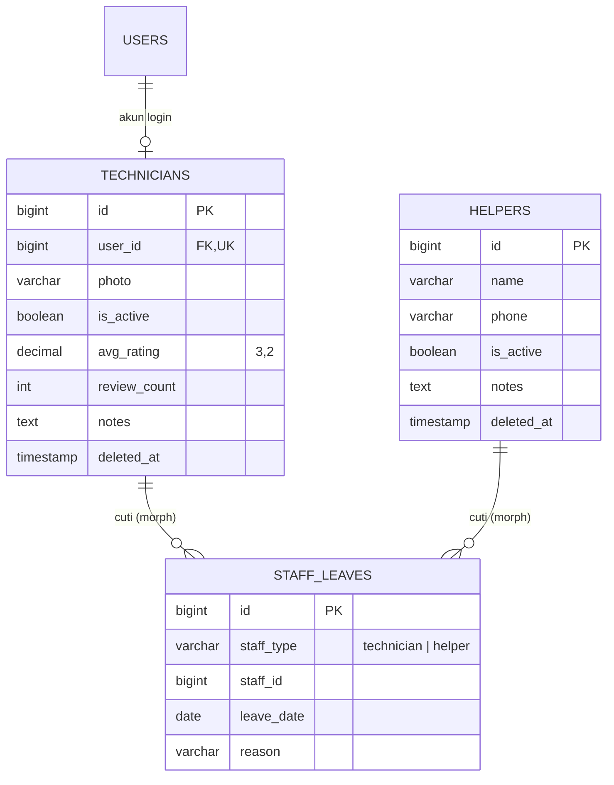
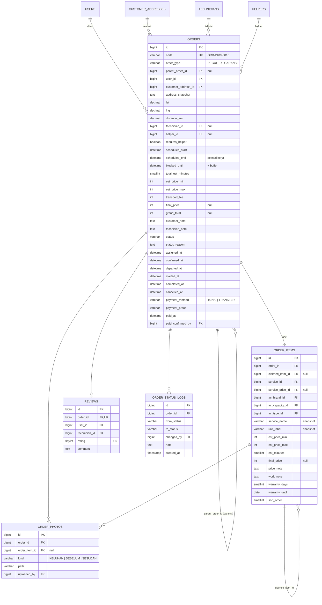

# Booking AC — ERD & Kamus Data

Rancangan database untuk **Laravel 12 + MySQL 8** berdasarkan [WORKFLOW.md](WORKFLOW.md).
Dokumen ini menggantikan ERD ringkas di WORKFLOW.md bagian 11. Versi gambar (PNG) ada di folder [`erd/`](erd/).

**Konvensi**

| Hal | Aturan |
|---|---|
| Engine / charset | InnoDB · `utf8mb4_unicode_ci` |
| Primary key | `id` BIGINT UNSIGNED auto increment (`$table->id()`) |
| Nama tabel & kolom | `snake_case`, tabel jamak (konvensi Laravel) |
| Uang | Rupiah bulat → `INT UNSIGNED` (tanpa desimal) |
| Durasi | Disimpan dalam **menit** (`SMALLINT UNSIGNED`), ditampilkan sebagai jam |
| Koordinat | `DECIMAL(10,7)` untuk `lat` dan `lng` |
| Jarak | `DECIMAL(6,2)` km |
| Waktu | `DATETIME` (timezone aplikasi `Asia/Jakarta`) |
| Enum | Kolom `VARCHAR` + PHP Enum (`app/Enums`) — lebih mudah diubah daripada ENUM MySQL |
| Timestamps | Semua tabel punya `created_at`, `updated_at` kecuali disebut lain |

---

## 1. Gambaran Umum (relasi saja)



**16 tabel aplikasi** dalam 4 kelompok:

| Kelompok | Tabel |
|---|---|
| A. Pengguna & pengaturan | `users`, `customer_addresses`, `company_settings` |
| B. Master layanan & unit AC | `ac_brands`, `ac_capacities`, `ac_types`, `services`, `service_prices` |
| C. Tim | `technicians`, `helpers`, `staff_leaves` |
| D. Order & transaksi | `orders`, `order_items`, `order_photos`, `reviews`, `order_status_logs` |

Ditambah tabel bawaan Laravel: `password_reset_tokens`, `sessions`, `cache`, `jobs`, `failed_jobs`, `notifications` (notifikasi in-app).
Tabel pendukung: `order_code_sequences` (nomor urut kode order per bulan, lihat bagian 5).

---

## 2. Kelompok A — Pengguna & Pengaturan



### `users`
Satu tabel untuk semua peran; dibedakan dengan kolom `role`.

| Kolom | Tipe | Null | Default | Keterangan |
|---|---|---|---|---|
| id | BIGINT UNSIGNED | – | AI | PK |
| name | VARCHAR(120) | – | | |
| email | VARCHAR(191) | – | | **Unique** |
| google_id | VARCHAR(64) | ✓ | NULL | **Unique**. Diisi saat login Google (client) |
| avatar | VARCHAR(255) | ✓ | NULL | URL foto dari Google / upload |
| phone | VARCHAR(20) | ✓ | NULL | Wajib dilengkapi client setelah login pertama |
| role | VARCHAR(20) | – | `client` | `client` · `admin` · `teknisi` |
| password | VARCHAR(255) | ✓ | NULL | NULL untuk client (login Google saja) |
| is_active | TINYINT(1) | – | 1 | Admin bisa menonaktifkan akun |
| email_verified_at | TIMESTAMP | ✓ | NULL | |
| remember_token | VARCHAR(100) | ✓ | NULL | |
| deleted_at | TIMESTAMP | ✓ | NULL | Soft delete |

Index: `role`.

### `customer_addresses`

| Kolom | Tipe | Null | Default | Keterangan |
|---|---|---|---|---|
| id | BIGINT UNSIGNED | – | AI | PK |
| user_id | BIGINT UNSIGNED | – | | FK → users.id (**cascade** on delete) |
| label | VARCHAR(50) | – | | Rumah / Kantor / bebas |
| address | TEXT | – | | Alamat lengkap |
| landmark | VARCHAR(255) | ✓ | NULL | Patokan |
| lat | DECIMAL(10,7) | – | | Titik dari peta Leaflet |
| lng | DECIMAL(10,7) | – | | |
| distance_km | DECIMAL(6,2) | – | | Jarak Haversine ke kantor, dihitung saat simpan |
| is_default | TINYINT(1) | – | 0 | Maks. 1 per user (dijaga di aplikasi) |
| deleted_at | TIMESTAMP | ✓ | NULL | Soft delete — order lama tetap valid |

Index: `user_id`.
> Jika koordinat kantor diubah dari halaman Pengaturan, job `RecalculateAddressDistances` (antrean) menghitung ulang `distance_km` semua alamat. Manual: `php artisan addresses:recalculate-distances`. Perubahan radius tidak perlu hitung ulang karena jangkauan dicek dari `distance_km` saat dipakai.

### `company_settings`
**Hanya 1 baris.** Profil perusahaan + semua pengaturan yang bisa diubah admin.

| Kolom | Tipe | Null | Default | Keterangan |
|---|---|---|---|---|
| id | BIGINT UNSIGNED | – | AI | PK |
| company_name | VARCHAR(120) | – | | |
| phone, email | VARCHAR(20) / VARCHAR(191) | ✓ | NULL | Kontak perusahaan |
| address | TEXT | – | | |
| lat, lng | DECIMAL(10,7) | – | | Titik kantor (acuan jarak) |
| open_time | TIME | – | 08:00 | Jam operasional mulai |
| close_time | TIME | – | 18:00 | Semua order harus selesai (termasuk buffer) sebelum jam ini |
| working_days | JSON | – | `[1,2,3,4,5,6]` | Hari kerja, 1 = Senin … 7 = Minggu |
| slot_interval_minutes | SMALLINT UNSIGNED | – | 60 | Jarak antar pilihan jam untuk client |
| travel_buffer_minutes | SMALLINT UNSIGNED | – | 30 | Buffer perjalanan setelah tiap order |
| free_radius_km | DECIMAL(6,2) | – | 5.00 | Transport gratis di bawah radius ini |
| max_radius_km | DECIMAL(6,2) | – | 25.00 | Di atas ini order ditolak |
| fee_per_km | INT UNSIGNED | – | 3000 | Tarif per km di luar radius gratis |
| cancel_limit_hours | SMALLINT UNSIGNED | – | 3 | Batas client membatalkan sendiri |
| warranty_days | SMALLINT UNSIGNED | – | 7 | Garansi default |
| bank_name, bank_account_no, bank_account_name | VARCHAR(100) / VARCHAR(50) / VARCHAR(120) | ✓ | NULL | Info transfer di halaman pembayaran |

---

## 3. Kelompok B — Master Layanan & Unit AC



### `ac_brands` · `ac_capacities` · `ac_types`
Tabel master sederhana.

| Tabel | Kolom khusus | Unique | Contoh |
|---|---|---|---|
| ac_brands | `name` VARCHAR(60) | name | Daikin, Panasonic, LG, Sharp, Gree |
| ac_capacities | `label` VARCHAR(20), `pk_value` DECIMAL(4,2) | pk_value | ½ PK (0.50), ¾ PK (0.75), 1 PK (1.00), 1½ PK (1.50), 2 PK, 2½ PK |
| ac_types | `name` VARCHAR(40) | name | Standar, Low Watt, Inverter |

Semua punya `is_active` TINYINT(1) default 1 dan `sort_order` SMALLINT default 0.

### `services`

| Kolom | Tipe | Null | Default | Keterangan |
|---|---|---|---|---|
| id | BIGINT UNSIGNED | – | AI | PK |
| name | VARCHAR(80) | – | | Cuci AC, Perbaikan, Instalasi, Isi Freon, … |
| slug | VARCHAR(100) | – | | **Unique** |
| description | TEXT | ✓ | NULL | |
| icon | VARCHAR(50) | ✓ | NULL | Nama ikon untuk UI |
| requires_helper | TINYINT(1) | – | 0 | Jika 1 → admin wajib pilih helper |
| warranty_days | SMALLINT UNSIGNED | ✓ | NULL | NULL = pakai `company_settings.warranty_days` |
| is_active | TINYINT(1) | – | 1 | |
| sort_order | SMALLINT | – | 0 | |
| deleted_at | TIMESTAMP | ✓ | NULL | Soft delete |

### `service_prices` — matriks harga Layanan × PK × Tipe

| Kolom | Tipe | Null | Default | Keterangan |
|---|---|---|---|---|
| id | BIGINT UNSIGNED | – | AI | PK |
| service_id | BIGINT UNSIGNED | – | | FK → services.id (**cascade**) |
| ac_capacity_id | BIGINT UNSIGNED | – | | FK → ac_capacities.id (**restrict**) |
| ac_type_id | BIGINT UNSIGNED | – | | FK → ac_types.id (**restrict**) |
| price_min | INT UNSIGNED | – | | Harga mulai |
| price_max | INT UNSIGNED | – | | Harga sampai (`≥ price_min`, CHECK) |
| est_minutes | SMALLINT UNSIGNED | – | | Estimasi durasi (mis. 90 = 1,5 jam) |
| is_active | TINYINT(1) | – | 1 | 0 = kombinasi tidak dilayani |

**Unique:** `(service_id, ac_capacity_id, ac_type_id)` — satu harga per kombinasi.
Helper "Terapkan ke semua / baris / kolom" di admin = satu `upsert()` ke banyak baris sekaligus.

---

## 4. Kelompok C — Tim (Teknisi, Helper, Cuti)



### `technicians`
Profil teknisi; login memakai baris di `users` (role `teknisi`). Nama, email, no. HP ada di `users`.

| Kolom | Tipe | Null | Default | Keterangan |
|---|---|---|---|---|
| id | BIGINT UNSIGNED | – | AI | PK |
| user_id | BIGINT UNSIGNED | – | | FK → users.id (**restrict**), **Unique** |
| photo | VARCHAR(255) | ✓ | NULL | |
| is_active | TINYINT(1) | – | 1 | Nonaktif = tidak muncul saat assign |
| avg_rating | DECIMAL(3,2) | – | 0.00 | Cache rata-rata dari `reviews` |
| review_count | INT UNSIGNED | – | 0 | Cache jumlah ulasan |
| notes | TEXT | ✓ | NULL | Catatan internal admin |
| deleted_at | TIMESTAMP | ✓ | NULL | Soft delete |

### `helpers`
Tanpa akun login.

| Kolom | Tipe | Null | Default | Keterangan |
|---|---|---|---|---|
| id | BIGINT UNSIGNED | – | AI | PK |
| name | VARCHAR(120) | – | | |
| phone | VARCHAR(20) | ✓ | NULL | |
| is_active | TINYINT(1) | – | 1 | |
| notes | TEXT | ✓ | NULL | |
| deleted_at | TIMESTAMP | ✓ | NULL | Soft delete |

### `staff_leaves`
Cuti teknisi & helper dalam satu tabel (relasi polymorphic Laravel `morphs('staff')`).

| Kolom | Tipe | Null | Keterangan |
|---|---|---|---|
| id | BIGINT UNSIGNED | – | PK |
| staff_type | VARCHAR(191) | – | Alias morph `technician` / `helper` (`Relation::enforceMorphMap` di `AppServiceProvider`) |
| staff_id | BIGINT UNSIGNED | – | id teknisi / helper |
| leave_date | DATE | – | Tanggal cuti (1 baris per hari) |
| reason | VARCHAR(255) | ✓ | |

**Unique:** `(staff_type, staff_id, leave_date)`.

> Morph map juga memuat `user` → `App\Models\User`, karena `notifications.notifiable_type` memakai relasi morph dan `enforceMorphMap` menolak model yang tidak terdaftar.

---

## 5. Kelompok D — Order & Transaksi



### `orders`

| Kolom | Tipe | Null | Default | Keterangan |
|---|---|---|---|---|
| id | BIGINT UNSIGNED | – | AI | PK |
| code | VARCHAR(20) | – | | **Unique**. Format `ORD-YYMM-NNNN` |
| order_type | VARCHAR(10) | – | `REGULER` | `REGULER` · `GARANSI` |
| parent_order_id | BIGINT UNSIGNED | ✓ | NULL | FK → orders.id (**restrict**). Order asal untuk klaim garansi |
| user_id | BIGINT UNSIGNED | – | | FK → users.id (**restrict**) — client |
| customer_address_id | BIGINT UNSIGNED | – | | FK → customer_addresses.id (**restrict**) |
| address_snapshot | TEXT | – | | Salinan alamat + patokan saat order dibuat |
| lat, lng | DECIMAL(10,7) | – | | Salinan koordinat |
| distance_km | DECIMAL(6,2) | – | | Salinan jarak |
| technician_id | BIGINT UNSIGNED | ✓ | NULL | FK → technicians.id (**restrict**). Diisi saat assign |
| helper_id | BIGINT UNSIGNED | ✓ | NULL | FK → helpers.id (**restrict**) |
| requires_helper | TINYINT(1) | – | 0 | 1 jika ada item dengan layanan wajib helper |
| scheduled_start | DATETIME | – | | Tanggal + jam mulai pilihan client |
| scheduled_end | DATETIME | – | | `scheduled_start + total_est_minutes` |
| blocked_until | DATETIME | – | | `scheduled_end + travel_buffer_minutes` → dipakai cek bentrok |
| total_est_minutes | SMALLINT UNSIGNED | – | | Σ `order_items.est_minutes` |
| est_price_min | INT UNSIGNED | – | | Σ item (belum termasuk transport) |
| est_price_max | INT UNSIGNED | – | | Σ item |
| transport_fee | INT UNSIGNED | – | 0 | 0 untuk order garansi |
| final_price | INT UNSIGNED | ✓ | NULL | Σ `order_items.final_price`, diisi saat laporan dikirim |
| grand_total | INT UNSIGNED | ✓ | NULL | `final_price + transport_fee` |
| customer_note | TEXT | ✓ | NULL | Keluhan / catatan client |
| technician_note | TEXT | ✓ | NULL | Catatan umum laporan teknisi |
| status | VARCHAR(20) | – | `MENUNGGU` | Lihat enum di bagian 7 |
| status_reason | TEXT | ✓ | NULL | Alasan ditolak / dibatalkan |
| assigned_at | DATETIME | ✓ | NULL | Waktu tiap perubahan status (untuk timeline) |
| confirmed_at | DATETIME | ✓ | NULL | |
| departed_at | DATETIME | ✓ | NULL | |
| started_at | DATETIME | ✓ | NULL | |
| completed_at | DATETIME | ✓ | NULL | Awal hitungan garansi |
| cancelled_at | DATETIME | ✓ | NULL | Juga dipakai untuk DITOLAK |
| payment_method | VARCHAR(10) | ✓ | NULL | `TUNAI` · `TRANSFER` |
| payment_proof | VARCHAR(255) | ✓ | NULL | Path bukti transfer (opsional), disk privat `local` — hanya admin |
| paid_at | DATETIME | ✓ | NULL | |
| paid_confirmed_by | BIGINT UNSIGNED | ✓ | NULL | FK → users.id (admin) |

**Index:**
- `(technician_id, scheduled_start)` dan `(helper_id, scheduled_start)` → cek bentrok jadwal
- `(status, scheduled_start)` → daftar order admin & dashboard
- `(user_id, created_at)` → "Order Saya" client
- `parent_order_id`

### `order_items` — unit AC dalam order

| Kolom | Tipe | Null | Default | Keterangan |
|---|---|---|---|---|
| id | BIGINT UNSIGNED | – | AI | PK |
| order_id | BIGINT UNSIGNED | – | | FK → orders.id (**cascade**) |
| claimed_item_id | BIGINT UNSIGNED | ✓ | NULL | FK → order_items.id. Pada order GARANSI: unit asal yang diklaim |
| service_id | BIGINT UNSIGNED | – | | FK → services.id (**restrict**) |
| service_price_id | BIGINT UNSIGNED | ✓ | NULL | FK → service_prices.id (**set null**). Acuan saja |
| ac_brand_id | BIGINT UNSIGNED | – | | FK → ac_brands.id |
| ac_capacity_id | BIGINT UNSIGNED | – | | FK → ac_capacities.id |
| ac_type_id | BIGINT UNSIGNED | – | | FK → ac_types.id |
| service_name | VARCHAR(80) | – | | Snapshot nama layanan |
| unit_label | VARCHAR(120) | – | | Snapshot, mis. "LG · 1½ PK · Inverter" |
| est_price_min | INT UNSIGNED | – | | Snapshot dari `service_prices` (0 untuk garansi) |
| est_price_max | INT UNSIGNED | – | | |
| est_minutes | SMALLINT UNSIGNED | – | | Snapshot durasi |
| final_price | INT UNSIGNED | ✓ | NULL | Diisi teknisi di laporan |
| price_note | TEXT | ✓ | NULL | **Wajib** jika `final_price > est_price_max` |
| work_note | TEXT | ✓ | NULL | Catatan pengerjaan unit (opsional) |
| warranty_days | SMALLINT UNSIGNED | – | | Snapshot: `services.warranty_days` ?? default |
| warranty_until | DATE | ✓ | NULL | `completed_at + warranty_days`, diisi saat SELESAI |
| sort_order | SMALLINT | – | 0 | Urutan Unit 1, 2, … |

Index: `order_id`, `claimed_item_id`, `warranty_until`.

### `order_photos`

| Kolom | Tipe | Null | Keterangan |
|---|---|---|---|
| id | BIGINT UNSIGNED | – | PK |
| order_id | BIGINT UNSIGNED | – | FK → orders.id (**cascade**) |
| order_item_id | BIGINT UNSIGNED | ✓ | FK → order_items.id (**cascade**). NULL = foto umum order |
| kind | VARCHAR(10) | – | `KELUHAN` (client, klaim garansi) · `SEBELUM` · `SESUDAH` (teknisi) |
| path | VARCHAR(255) | – | Path di storage `public` |
| uploaded_by | BIGINT UNSIGNED | – | FK → users.id |

Index: `(order_item_id, kind)`.
Aturan: min. 1 foto `SESUDAH` per item sebelum laporan bisa dikirim.

### `reviews`

| Kolom | Tipe | Null | Keterangan |
|---|---|---|---|
| id | BIGINT UNSIGNED | – | PK |
| order_id | BIGINT UNSIGNED | – | FK → orders.id (**cascade**), **Unique** → 1 ulasan per order |
| user_id | BIGINT UNSIGNED | – | FK → users.id (client penulis) |
| technician_id | BIGINT UNSIGNED | – | FK → technicians.id (disalin dari order) |
| rating | TINYINT UNSIGNED | – | 1–5 (CHECK) |
| comment | TEXT | ✓ | |

Index: `technician_id`. Setelah simpan → hitung ulang `technicians.avg_rating` & `review_count`.

### `order_code_sequences` — nomor urut kode order

| Kolom | Tipe | Null | Keterangan |
|---|---|---|---|
| period | CHAR(4) | – | **PK**. `YYMM`, mis. `2610` |
| last_number | INT UNSIGNED | – | Nomor terakhir yang dipakai di bulan itu |

Tanpa timestamps. Dinaikkan oleh `OrderCodeGenerator` dengan satu statement atomik
`INSERT … ON DUPLICATE KEY UPDATE last_number = LAST_INSERT_ID(last_number + 1)` → aman dipakai bersamaan,
nomor otomatis mulai dari 1 tiap bulan baru.

### `order_status_logs`

| Kolom | Tipe | Null | Keterangan |
|---|---|---|---|
| id | BIGINT UNSIGNED | – | PK |
| order_id | BIGINT UNSIGNED | – | FK → orders.id (**cascade**) |
| from_status | VARCHAR(20) | ✓ | NULL untuk status pertama |
| to_status | VARCHAR(20) | – | |
| changed_by | BIGINT UNSIGNED | ✓ | FK → users.id (**set null**). NULL = sistem |
| note | TEXT | ✓ | Mis. alasan teknisi menolak, teknisi lama saat diganti |
| created_at | TIMESTAMP | – | Tanpa `updated_at` |

Index: `(order_id, created_at)`.

---

## 6. Ringkasan Relasi & Aturan Hapus

| Relasi | Kardinalitas | On delete |
|---|---|---|
| users → customer_addresses | 1 : N | cascade |
| users → technicians | 1 : 0..1 | restrict |
| users → orders (client) | 1 : N | restrict |
| customer_addresses → orders | 1 : N | restrict (alamat pakai soft delete) |
| services → service_prices | 1 : N | cascade |
| ac_capacities / ac_types → service_prices | 1 : N | restrict |
| technicians → orders | 1 : N | restrict |
| helpers → orders | 1 : N | restrict |
| technicians / helpers → staff_leaves | 1 : N (morph) | hapus di aplikasi |
| orders → orders (garansi) | 1 : N | restrict |
| orders → order_items | 1 : 1..N | cascade |
| order_items → order_items (klaim) | 1 : N | restrict |
| orders / order_items → order_photos | 1 : N | cascade |
| orders → reviews | 1 : 0..1 | cascade |
| technicians → reviews | 1 : N | restrict |
| orders → order_status_logs | 1 : N | cascade |

> Data master & orang memakai **soft delete**, jadi `restrict` jarang terpicu; data transaksi tetap utuh untuk laporan.

---

## 7. Nilai Enum (PHP Enum di `app/Enums`)

| Enum | Nilai |
|---|---|
| `UserRole` | `client`, `admin`, `teknisi` |
| `OrderType` | `REGULER`, `GARANSI` |
| `OrderStatus` | `MENUNGGU`, `DITUGASKAN`, `DIKONFIRMASI`, `DALAM_PERJALANAN`, `DIKERJAKAN`, `SELESAI`, `LUNAS`, `DITOLAK`, `DIBATALKAN` |
| `PaymentMethod` | `TUNAI`, `TRANSFER` |
| `PhotoKind` | `KELUHAN`, `SEBELUM`, `SESUDAH` |

Status yang **mengunci jadwal** (dipakai cek bentrok): semua kecuali `DITOLAK` dan `DIBATALKAN`.
Order dengan `grand_total = 0` (garansi) berhenti di `SELESAI`; lainnya lanjut ke `LUNAS`.

---

## 8. Query Kunci

**Cari harga untuk satu unit** (form order client):
```sql
SELECT price_min, price_max, est_minutes
FROM service_prices
WHERE service_id = :service AND ac_capacity_id = :pk AND ac_type_id = :type
  AND is_active = 1;
```

**Cek teknisi bentrok** (sama untuk helper dengan `helper_id`):
```sql
SELECT EXISTS (
  SELECT 1 FROM orders
  WHERE technician_id = :tech
    AND status NOT IN ('DITOLAK','DIBATALKAN')
    AND id <> :current_order
    AND scheduled_start < :new_blocked_until
    AND blocked_until   > :new_start
) AS bentrok;
```
Jalankan di dalam `DB::transaction()` dengan `lockForUpdate()` pada baris teknisi agar dua admin tidak meng-assign slot yang sama bersamaan.

**Teknisi free di slot tertentu** (untuk daftar pilihan admin & slot jam client):
```sql
SELECT t.* FROM technicians t
WHERE t.is_active = 1 AND t.deleted_at IS NULL
  AND NOT EXISTS (SELECT 1 FROM staff_leaves l
                  WHERE l.staff_type = 'technician' AND l.staff_id = t.id
                    AND l.leave_date = DATE(:new_start))
  AND NOT EXISTS (SELECT 1 FROM orders o
                  WHERE o.technician_id = t.id
                    AND o.status NOT IN ('DITOLAK','DIBATALKAN')
                    AND o.scheduled_start < :new_blocked_until
                    AND o.blocked_until   > :new_start);
```

**Unit yang masih bisa diklaim garansi:**
```sql
SELECT i.* FROM order_items i
JOIN orders o ON o.id = i.order_id
WHERE o.user_id = :client AND o.order_type = 'REGULER'
  AND i.warranty_until >= CURDATE()
  AND NOT EXISTS (SELECT 1 FROM order_items c
                  JOIN orders co ON co.id = c.order_id
                  WHERE c.claimed_item_id = i.id
                    AND co.status NOT IN ('DITOLAK','DIBATALKAN','SELESAI','LUNAS'));
```

---

## 9. Urutan Migration

1. `users` (modifikasi bawaan Laravel: `google_id`, `avatar`, `phone`, `role`, `is_active`, `password` nullable, soft delete)
2. `company_settings`
3. `customer_addresses`
4. `ac_brands`, `ac_capacities`, `ac_types`
5. `services`
6. `service_prices`
7. `technicians`, `helpers`
8. `staff_leaves`
9. `orders`
10. `order_items`
11. `order_photos`
12. `reviews`
13. `order_status_logs`
14. `notifications` (`php artisan make:notifications-table`)
15. `order_code_sequences`

**Seeder awal:** 1 admin, `company_settings` (1 baris), merk, PK, tipe, 4 layanan + matriks harga contoh.
