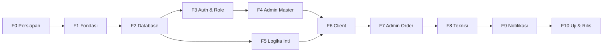

# Booking AC — Rencana Task Development

Acuan: [WORKFLOW.md](WORKFLOW.md) · [ERD.md](ERD.md) · [mockup/](../mockup/index.html)
Stack: Laravel 12 (Blade + Tailwind + Alpine.js) · MySQL 8 · Leaflet · Notifikasi in-app + email

---

## Cara Kerja Bersama Claude

1. **Satu task per perintah.** Cukup tulis: `Kerjakan T-203`. Claude membaca task ini + WORKFLOW/ERD/mockup, menulis kode, menjalankan test, lalu mencentang task di file ini.
2. **Urutan mengikuti kolom "Butuh".** Task tanpa ketergantungan yang belum selesai boleh dikerjakan.
3. **Selesai = semua poin "Selesai jika" terpenuhi** dan `php artisan test` hijau.
4. **Satu task = satu commit git** dengan pesan `T-203: <judul>`.
5. **Menjalankan aplikasi dilakukan di Mac Anda** (Laravel Herd). Shell yang bisa dipakai Claude di komputer Anda belum punya PHP dan akses ke Packagist, jadi Claude menjalankan `composer` dan test di workspace-nya sendiri lalu menyalin kode ke folder ini. Folder `vendor/` dan `node_modules/` tidak disalin; jalankan `composer install` dan `npm install` di Mac bila diminta.
6. Task bertanda 👤 dikerjakan **oleh Anda** (akun, instalasi, keputusan).

**Label ukuran:** S = kecil (< ½ hari) · M = sedang (± 1 hari) · L = besar (1–2 hari)
**Label prioritas:** `Inti` = wajib untuk MVP · `Lanjutan` = boleh setelah MVP berjalan

---

## Peta Fase

**Milestone MVP** = semua task `Inti` di F0–F8 selesai → alur lengkap *order → assign → laporan → lunas → ulasan* bisa dipakai tanpa email.

---

## Ringkasan Checklist

| | ID | Task | Ukuran | Prioritas | Butuh |
|---|---|---|---|---|---|
| **F0** | | **Persiapan** | | | |
| [x] | T-001 | 👤 Install Laravel Herd, MySQL & buat database | S | Inti | – |
| [ ] | T-002 | 👤 Buat Google OAuth Client ID | S | Inti | – |
| [ ] | T-003 | 👤 Siapkan SMTP dev (Mailpit/Mailtrap) | S | Lanjutan | – |
| [ ] | T-004 | 👤 Tetapkan nama perusahaan, logo, rekening | S | Inti | – |
| **F1** | | **Fondasi proyek** | | | |
| [x] | T-101 | Buat project Laravel 12 + git | S | Inti | T-001 |
| [ ] | T-102 | Tailwind, Alpine, font & design token | S | Inti | T-101 |
| [ ] | T-103 | Komponen Blade dasar (UI kit) | M | Inti | T-102 |
| [x] | T-104 | Tooling: Pest, Pint, Larastan | S | Inti | T-101 |
| [x] | T-105 | PHP Enum (role, status, dll.) | S | Inti | T-101 |
| **F2** | | **Database** | | | |
| [ ] | T-201 | Migration kelompok A (users, settings, alamat) | S | Inti | T-105 |
| [ ] | T-202 | Migration kelompok B (master AC, layanan, harga) | S | Inti | T-201 |
| [ ] | T-203 | Migration kelompok C (teknisi, helper, cuti) | S | Inti | T-201 |
| [ ] | T-204 | Migration kelompok D (order & turunannya) | M | Inti | T-202, T-203 |
| [ ] | T-205 | Model, relasi, cast & factory | M | Inti | T-204 |
| [ ] | T-206 | Seeder data awal + data demo | M | Inti | T-205 |
| **F3** | | **Auth & role** | | | |
| [ ] | T-301 | Login Google untuk client | M | Inti | T-205, T-002 |
| [ ] | T-302 | Login admin & teknisi (email + password) | S | Inti | T-205 |
| [ ] | T-303 | Middleware role, route group, policy dasar | S | Inti | T-301, T-302 |
| [ ] | T-304 | Lengkapi profil client (no. HP) | S | Inti | T-303 |
| **F4** | | **Admin — master data** | | | |
| [ ] | T-401 | Layout admin + sidebar | S | Inti | T-103, T-303 |
| [ ] | T-402 | Company profile & pengaturan (peta Leaflet) | M | Inti | T-401 |
| [ ] | T-403 | CRUD Merk, PK, Tipe AC | M | Inti | T-401 |
| [ ] | T-404 | CRUD Layanan | S | Inti | T-401 |
| [ ] | T-405 | Matriks harga + "Terapkan ke semua/baris/kolom" | L | Inti | T-403, T-404 |
| [ ] | T-406 | CRUD Teknisi (sekaligus akun login) | M | Inti | T-401 |
| [ ] | T-407 | CRUD Helper | S | Inti | T-401 |
| [ ] | T-408 | Cuti teknisi & helper | S | Inti | T-406, T-407 |
| [ ] | T-409 | Daftar client (lihat & nonaktifkan) | S | Lanjutan | T-401 |
| **F5** | | **Logika inti (service class + unit test)** | | | |
| [ ] | T-501 | Jarak Haversine & biaya transport | S | Inti | T-205 |
| [ ] | T-502 | Kalkulasi harga & durasi order | S | Inti | T-205 |
| [ ] | T-503 | Cek jadwal bentrok & slot tersedia | L | Inti | T-205 |
| [ ] | T-504 | Mesin status order + log | M | Inti | T-205 |
| [ ] | T-505 | Generator kode order | S | Inti | T-205 |
| **F6** | | **Client** | | | |
| [ ] | T-601 | Layout mobile client + beranda | M | Inti | T-103, T-304 |
| [ ] | T-602 | Alamat saya + pilih titik di peta | L | Inti | T-601, T-501 |
| [ ] | T-603 | Buat order — langkah unit AC | L | Inti | T-602, T-502, T-405 |
| [ ] | T-604 | Buat order — jadwal, ringkasan & simpan | L | Inti | T-603, T-503, T-504, T-505 |
| [ ] | T-605 | Order saya + detail & timeline | M | Inti | T-604 |
| [ ] | T-606 | Batalkan order (batas 3 jam) | S | Inti | T-605 |
| [ ] | T-607 | Lihat laporan & info pembayaran | S | Inti | T-605 |
| [ ] | T-608 | Rating & ulasan | S | Inti | T-607 |
| [ ] | T-609 | Klaim garansi | M | Lanjutan | T-607 |
| **F7** | | **Admin — operasional order** | | | |
| [ ] | T-701 | Daftar order + filter | M | Inti | T-604 |
| [ ] | T-702 | Detail order + assign teknisi & helper | L | Inti | T-701, T-503, T-408 |
| [ ] | T-703 | Tolak & batalkan order oleh admin | S | Inti | T-702 |
| [ ] | T-704 | Konfirmasi pembayaran → LUNAS | S | Inti | T-702 |
| [ ] | T-705 | Jadwal harian (timeline) | M | Lanjutan | T-702 |
| [ ] | T-706 | Dashboard statistik | S | Lanjutan | T-704 |
| [ ] | T-707 | Daftar ulasan | S | Lanjutan | T-608 |
| **F8** | | **Teknisi** | | | |
| [ ] | T-801 | Layout teknisi + daftar tugas | M | Inti | T-702 |
| [ ] | T-802 | Terima / tolak tugas | S | Inti | T-801 |
| [ ] | T-803 | Berangkat & mulai kerja | S | Inti | T-802 |
| [ ] | T-804 | Laporan per unit (foto, catatan, harga final) | L | Inti | T-803 |
| [ ] | T-805 | Riwayat tugas & rating saya | S | Lanjutan | T-804 |
| **F9** | | **Notifikasi** | | | |
| [ ] | T-901 | Setup mail, queue & template email | S | Lanjutan | T-003, T-504 |
| [ ] | T-902 | Kelas notifikasi per event | M | Lanjutan | T-901 |
| [ ] | T-903 | Lonceng notifikasi in-app (3 role) | M | Lanjutan | T-902 |
| [ ] | T-904 | Pengingat H-1 (scheduler) | S | Lanjutan | T-902 |
| **F10** | | **Uji & rilis** | | | |
| [ ] | T-1001 | Test alur end-to-end | M | Inti | T-804 |
| [ ] | T-1002 | Review keamanan | S | Inti | T-1001 |
| [ ] | T-1003 | Review performa & query | S | Lanjutan | T-1001 |
| [ ] | T-1004 | Persiapan deploy | M | Inti | T-1002 |
| [ ] | T-1005 | 👤 UAT per role | M | Inti | T-1004 |

---

## Detail Task

### F0 — Persiapan

#### T-001 · 👤 Install Laravel Herd, MySQL & buat database
- Install **Laravel Herd** (PHP 8.3+, Composer, Node sudah termasuk) dan **DBngin** (atau MySQL 8 via Homebrew).
- Buat database `booking_ac` (utf8mb4) dan user-nya.
- Tautkan folder `Booking-AC` di Herd → aplikasi terbuka di `http://booking-ac.test`.
- **Selesai jika:** `php -v` ≥ 8.3, `composer -V` jalan, bisa login ke MySQL.
- *Status:* MySQL 9.3 (Homebrew) aktif, database `booking_ac` + `booking_ac_test` dibuat. PHP masih 8.2 (cukup untuk Laravel 12); Herd belum terpasang → pakai `php artisan serve`.

#### T-002 · 👤 Google OAuth Client ID
- Google Cloud Console → buat project → OAuth consent screen (External) → Credentials → OAuth Client ID (Web).
- Authorized redirect URI: `http://booking-ac.test/auth/google/callback` (tambahkan domain produksi nanti).
- **Selesai jika:** punya `GOOGLE_CLIENT_ID` dan `GOOGLE_CLIENT_SECRET` (simpan, jangan dikirim di chat — isi sendiri di `.env`).

#### T-003 · 👤 SMTP untuk development
- Pakai **Mailpit** (gratis, lokal) atau akun Mailtrap.
- **Selesai jika:** punya host, port, username, password SMTP dev.

#### T-004 · 👤 Identitas perusahaan
- Nama perusahaan (pengganti "SejukAC"), logo (SVG/PNG), alamat & titik kantor, nomor rekening, email pengirim.
- **Selesai jika:** data dikirim ke Claude atau diisi langsung di seeder T-206.

---

### F1 — Fondasi Proyek

#### T-101 · Buat project Laravel 12 + git
- `composer create-project laravel/laravel` di folder proyek (docs/ & mockup/ tetap).
- Atur `.env.example` (MySQL, `APP_TIMEZONE=Asia/Jakarta`, `APP_LOCALE=id`), `.gitignore`, `README.md` berisi langkah setup lokal.
- `git init` + commit awal.
- **Selesai jika:** `php artisan --version` menampilkan 12.x, halaman awal terbuka di Herd, `php artisan migrate` sukses ke MySQL.

#### T-102 · Tailwind, Alpine, font & design token
- Tailwind CSS v4 + Vite + Alpine.js.
- Font Plus Jakarta Sans di-host lokal (bukan Google Fonts) dari paket `@fontsource`.
- Token warna dari [StyleGuide](../mockup/StyleGuide.html): `primary #1D63ED`, `primary-hover #1650C4`, `navy #00084D`, `blue-50 #E8F0FE`, `ink #0B1533`, `muted #5B6780`, `line #E3E8F2`, `surface-bg #F4F7FC`, success/warning/danger.
- **Selesai jika:** `npm run build` sukses, class seperti `bg-primary text-navy` bekerja.

#### T-103 · Komponen Blade dasar (UI kit)
- Anonymous components di `resources/views/components/`: `button` (primary/secondary/danger, ukuran), `input`, `textarea`, `select`, `checkbox`, `toggle`, `label`, `field-error`, `card`, `badge` (termasuk badge per `OrderStatus`), `modal` (Alpine), `flash`, `empty-state`, `icon` (paket `blade-ui-kit/blade-icons` + Lucide).
- Halaman `/dev/ui` (hanya `APP_ENV=local`) memperlihatkan semua komponen.
- **Selesai jika:** `/dev/ui` tampil sesuai mockup; semua input punya label & fokus terlihat; target sentuh ≥ 44px.

#### T-104 · Tooling
- Pest (test), Laravel Pint (format), Larastan level 5 (analisis).
- Script composer: `composer test`, `composer lint`, `composer analyse`.
- **Selesai jika:** ketiga perintah jalan tanpa error pada project kosong.

#### T-105 · PHP Enum
- `app/Enums`: `UserRole`, `OrderType`, `OrderStatus`, `PaymentMethod`, `PhotoKind` (nilai persis seperti ERD bagian 7).
- Tiap enum punya `label()` (Bahasa Indonesia); `OrderStatus` punya `color()` untuk badge dan `locksSchedule()`.
- **Selesai jika:** unit test untuk label & `locksSchedule()` lulus.

---

### F2 — Database

#### T-201 · Migration kelompok A
- Ubah migration `users` bawaan: `google_id` (unique, null), `avatar`, `phone`, `role`, `is_active`, `password` nullable, soft delete.
- `company_settings`, `customer_addresses` sesuai ERD.
- **Selesai jika:** `migrate:fresh` sukses; struktur sama dengan kamus data ERD.

#### T-202 · Migration kelompok B
- `ac_brands`, `ac_capacities`, `ac_types`, `services`, `service_prices` (unique kombinasi + CHECK `price_max >= price_min`).

#### T-203 · Migration kelompok C
- `technicians`, `helpers`, `staff_leaves` (morphs + unique) + `Relation::enforceMorphMap(['technician' => Technician::class, 'helper' => Helper::class])`.

#### T-204 · Migration kelompok D
- `orders`, `order_items`, `order_photos`, `reviews`, `order_status_logs` + semua index & FK sesuai ERD bagian 5–6.
- Tabel `notifications`.
- **Selesai jika:** `migrate:fresh` sukses; `SHOW INDEX` memperlihatkan index jadwal `(technician_id, scheduled_start)` dan `(helper_id, scheduled_start)`.

#### T-205 · Model, relasi, cast & factory
- Model untuk 17 tabel, relasi lengkap (termasuk `parentOrder`, `warrantyClaims`, `claimedItem`, morph `leaves`), cast enum/datetime/decimal, `SoftDeletes` di tabel yang relevan.
- `CompanySettings::current()` (1 baris, di-cache, cache dihapus saat update).
- Factory untuk semua model.
- **Selesai jika:** test relasi utama lulus (order → items → photos, teknisi → orders, dll.).

#### T-206 · Seeder
- `DatabaseSeeder`: 1 admin, `company_settings`, merk, PK (½–2½), tipe (Standar, Low Watt, Inverter), 4 layanan (Cuci AC, Perbaikan, Instalasi [wajib helper], Isi Freon) + matriks harga contoh.
- `DemoSeeder` (hanya lokal): 4 teknisi, 2 helper, 5 client, ± 20 order berbagai status.
- **Selesai jika:** `php artisan migrate:fresh --seed` sukses; login admin tercatat di README.

---

### F3 — Auth & Role

#### T-301 · Login Google (client)
- `laravel/socialite`; route `auth/google/redirect` & `callback`.
- User baru → dibuat dengan role `client`; user lama → di-link via email; akun non-client tidak boleh masuk lewat Google.
- **Selesai jika:** test callback (Socialite di-mock) membuat/menautkan user; user nonaktif ditolak.

#### T-302 · Login admin & teknisi
- Halaman login email + password (desain mengikuti mockup), rate limit 5x/menit, logout.
- Redirect sesuai role: admin → `/admin`, teknisi → `/teknisi`.

#### T-303 · Middleware role, route group, policy dasar
- Middleware `role:admin|teknisi|client`; file route terpisah (`routes/client.php`, `admin.php`, `teknisi.php`).
- Policy `OrderPolicy` (client hanya order miliknya, teknisi hanya order yang ditugaskan).
- **Selesai jika:** test akses silang role → 403.

#### T-304 · Lengkapi profil client
- Setelah login pertama tanpa no. HP → wajib isi no. HP (validasi format Indonesia `08…`/`+62…`).
- Halaman profil (nama, no. HP, logout).

---

### F4 — Admin: Master Data

#### T-401 · Layout admin
- Sidebar navy sesuai mockup, topbar, flash message, breadcrumb, badge jumlah order MENUNGGU.

#### T-402 · Company profile & pengaturan
- Form semua kolom `company_settings`; pilih titik kantor di peta Leaflet (marker bisa digeser).
- Jika koordinat/radius berubah → job `RecalculateAddressDistances` menghitung ulang `distance_km` semua alamat.
- **Selesai jika:** validasi (`max_radius > free_radius`, `close_time > open_time`) & test job lulus.

#### T-403 · CRUD Merk, PK, Tipe
- Satu pola CRUD reusable: tabel, tambah/edit di modal, aktif/nonaktif, urutkan (sort_order).
- Tidak bisa dihapus jika sudah dipakai order → cukup dinonaktifkan.

#### T-404 · CRUD Layanan
- Tab "Info layanan": nama, slug otomatis, deskripsi, ikon, wajib helper, garansi (kosong = default), aktif.

#### T-405 · Matriks harga
- Tab "Matriks harga" sesuai [mockup Admin-Harga](../mockup/Admin-Harga.html): grid PK × Tipe, tiap sel harga mulai/sampai, estimasi (jam, disimpan menit), sakelar aktif.
- Panel "Isi cepat" (Alpine): Terapkan ke **semua** / **baris PK** / **kolom tipe**; sel target di-highlight; edit per sel tetap bisa.
- Simpan sekali dengan `upsert()`.
- **Selesai jika:** test validasi (`price_min ≤ price_max`, menit > 0) dan test upsert lulus; PK/tipe baru otomatis muncul sebagai sel kosong.

#### T-406 · CRUD Teknisi
- Tambah teknisi = buat `users` (role teknisi, password awal) + `technicians`. Edit, nonaktifkan, reset password.

#### T-407 · CRUD Helper
- Nama, no. HP, aktif, catatan.

#### T-408 · Cuti
- Dari halaman teknisi/helper: tambah/hapus tanggal cuti (bisa rentang tanggal → dipecah per hari).
- Peringatan jika tanggal cuti bentrok dengan order yang sudah ditugaskan.

#### T-409 · Daftar client
- Tabel client + jumlah order + alamat; tombol nonaktifkan.

---

### F5 — Logika Inti
Semua di `app/Services`, tanpa ketergantungan ke controller, **wajib unit test**.

#### T-501 · `DistanceService` & `TransportFeeCalculator`
- Haversine (km, 2 desimal); biaya = `ceil(jarak − radius_gratis) × tarif_per_km`, 0 jika di dalam radius, exception jika > radius maks.
- **Test:** 8,4 km (gratis 5, Rp3.000) → Rp12.000; 4,9 km → Rp0; 26 km (maks 25) → ditolak.

#### T-502 · `OrderEstimator`
- Input: daftar unit (layanan, PK, tipe) → cari `service_prices` aktif → total min/max, total menit, `requires_helper`.
- Kombinasi tanpa harga → error per unit yang jelas.
- **Test:** contoh 2 unit di mockup menghasilkan Rp185.000–Rp220.000 dan 150 menit.

#### T-503 · `ScheduleService`
- `isFree(staff, start, blockedUntil, ignoreOrderId)` — cek aktif, cuti, bentrok (query ERD bagian 8).
- `freeTechnicians(start, blockedUntil)` / `freeHelpers(...)`.
- `availableSlots(date, totalMinutes, needsHelper)` — slot tiap `slot_interval_minutes` dari `open_time`, hanya hari kerja, `blocked_until ≤ close_time`, bukan waktu lampau, minimal 1 teknisi (+1 helper) free.
- **Test:** skenario tabel di WORKFLOW bagian 9 (09:00–10:30 vs 10:30 tidak bentrok, 12:00 bentrok), cuti, jam tutup, hari libur.

#### T-504 · `OrderStatusService`
- Peta transisi sesuai state machine WORKFLOW bagian 3, termasuk siapa yang boleh (client/admin/teknisi).
- Setiap transisi: isi kolom waktu (`assigned_at`, …), tulis `order_status_logs`, pancarkan event `OrderStatusChanged` (dipakai notifikasi di F9).
- Aturan batal client: ≥ `cancel_limit_hours` sebelum `scheduled_start`.
- **Test:** semua transisi valid & tidak valid; batal 2 jam sebelum jadwal ditolak.

#### T-505 · Generator kode order
- Format `ORD-YYMM-NNNN`, nomor urut reset tiap bulan, aman dari balapan (transaction + lock).
- **Test:** 2 pembuatan bersamaan tidak menghasilkan kode sama.

---

### F6 — Client

#### T-601 · Layout client + beranda
- Layout mobile-first (tetap rapi di desktop: kolom tengah maks. 480px), bottom nav (Beranda, Order, Alamat, Profil).
- Beranda sesuai [mockup](../mockup/Client-Beranda.html): kartu order aktif, daftar layanan + harga mulai, garansi aktif, tombol Buat Order.

#### T-602 · Alamat saya
- List, tambah, edit, hapus (soft), set utama.
- Peta Leaflet + tile OSM: marker di tengah, tombol "Lokasi saya" (Geolocation), pencarian alamat via Nominatim (debounce, maks. 1 request/detik).
- Hitung jarak live (JS) + validasi ulang di server (T-501); tampilkan info jangkauan & biaya transport.
- **Selesai jika:** alamat di luar radius tidak bisa disimpan; test server-side lulus.

#### T-603 · Buat order — unit AC
- Wizard langkah 1 sesuai [mockup](../mockup/Client-Order-Unit.html): pilih alamat, tambah unit (merk, PK, tipe, layanan), **Salin unit**, hapus unit, **Terapkan ke semua unit** (layanan/merk/PK/tipe).
- Endpoint JSON `GET /order/estimate` (pakai T-502) untuk estimasi per unit & total; layanan yang tidak punya harga untuk kombinasi tersebut disembunyikan.
- State wizard disimpan di session agar aman saat refresh.

#### T-604 · Buat order — jadwal, ringkasan & simpan
- Langkah 2: strip tanggal (14 hari ke depan) + slot jam dari `availableSlots` (T-503); tanggal penuh ditandai.
- Langkah 3: ringkasan unit, transport, total estimasi, info pembayaran & batas batal.
- Simpan dalam `DB::transaction()`: **validasi ulang semua** (alamat, harga, slot masih tersedia), buat `orders` + `order_items` dengan snapshot, kode order, log status MENUNGGU.
- **Selesai jika:** feature test: order sukses; slot yang baru saja terisi ditolak dengan pesan jelas.

#### T-605 · Order saya + detail
- List dengan tab Aktif / Selesai / Dibatalkan.
- Detail sesuai [mockup](../mockup/Client-Detail.html): timeline status, teknisi & helper, unit.

#### T-606 · Batalkan order
- Tombol muncul hanya jika status MENUNGGU/DITUGASKAN/DIKONFIRMASI **dan** ≥ 3 jam sebelum jadwal; wajib isi alasan. Selain itu tampil "Hubungi admin" (link WhatsApp/telepon kantor).

#### T-607 · Laporan & pembayaran
- Tampilkan per unit: foto sebelum/sesudah (lightbox), catatan, harga final + keterangan tambahan; total & status bayar; info rekening dari pengaturan.

#### T-608 · Rating & ulasan
- Bisa diberikan sejak SELESAI, 1× per order; setelah simpan → hitung ulang rating teknisi.

#### T-609 · Klaim garansi
- Tombol "Klaim Garansi" jika ada unit dengan `warranty_until ≥ hari ini` dan belum ada klaim aktif.
- Pilih unit, keluhan, foto (opsional, `KELUHAN`), jadwal → buat order `GARANSI` Rp0 (`parent_order_id`, `claimed_item_id`).

---

### F7 — Admin: Operasional Order

#### T-701 · Daftar order
- Tab per status, filter tanggal/jenis/teknisi, cari kode/nama client, pagination.

#### T-702 · Detail order + assign
- Sesuai [mockup Admin-Assign](../mockup/Admin-Assign.html): info client + peta mini, unit & estimasi, catatan.
- Daftar teknisi & helper dengan status **Free / Bentrok / Cuti** + mini timeline hari itu; order garansi menyarankan teknisi order asal.
- Helper wajib jika `requires_helper`.
- Simpan dengan `lockForUpdate()` + cek ulang bentrok; ganti teknisi (status kembali DITUGASKAN, dicatat di log).
- **Selesai jika:** feature test: assign sukses, assign bentrok ditolak, helper wajib divalidasi.

#### T-703 · Tolak & batalkan oleh admin
- Tolak (MENUNGGU → DITOLAK) dan batalkan (sebelum DALAM_PERJALANAN) dengan alasan wajib.

#### T-704 · Konfirmasi pembayaran
- Dari order SELESAI: pilih metode (tunai/transfer), upload bukti (opsional) → LUNAS, catat `paid_confirmed_by`.
- Order dengan `grand_total = 0` tidak butuh langkah ini.

#### T-705 · Jadwal harian
- Timeline teknisi & helper per hari sesuai [mockup Admin-Jadwal](../mockup/Admin-Jadwal.html): blok per order berwarna status, buffer bergaris, garis waktu sekarang, navigasi tanggal.

#### T-706 · Dashboard
- Kartu: menunggu assign, jadwal hari ini, total belum lunas, rating rata-rata; tabel order menunggu; beban teknisi hari ini.

#### T-707 · Daftar ulasan
- Filter per teknisi & rating.

---

### F8 — Teknisi

#### T-801 · Layout teknisi + daftar tugas
- Mobile-first sesuai [mockup](../mockup/Teknisi-Tugas.html): header ringkasan, tab Hari ini / Mendatang / Riwayat, kartu tugas urut jam.

#### T-802 · Terima / tolak tugas
- Terima → DIKONFIRMASI. Tolak (alasan wajib) → MENUNGGU, `technician_id` dikosongkan, admin diberi tahu.

#### T-803 · Berangkat & mulai
- Tombol sesuai status: Berangkat → DALAM_PERJALANAN; Tiba & mulai → DIKERJAKAN.
- Tombol navigasi membuka Google Maps ke `lat,lng` order.

#### T-804 · Laporan per unit
- Sesuai [mockup](../mockup/Teknisi-Laporan.html): tab per unit, upload foto sebelum/sesudah (kamera HP via `<input capture>`), kompres & resize di server (`intervention/image`, maks. 1600px), catatan, harga final.
- Harga > estimasi maks → keterangan wajib.
- Kirim laporan: semua unit lengkap (min. 1 foto sesudah) → SELESAI, hitung `final_price`, `grand_total`, `warranty_until` tiap unit.
- **Selesai jika:** feature test: kirim tanpa foto ditolak; total & garansi terhitung benar.

#### T-805 · Riwayat & rating
- Daftar tugas selesai + ulasan yang diterima.

---

### F9 — Notifikasi

#### T-901 · Setup mail & queue
- Mail SMTP dari `.env`, queue driver `database`, template email markdown ber-branding (logo, warna biru).

#### T-902 · Kelas notifikasi
- Sesuai tabel WORKFLOW bagian 14, channel `database` + `mail`, dikirim via listener `OrderStatusChanged` (queued).
- **Selesai jika:** test `Notification::fake()` untuk tiap event.

#### T-903 · Lonceng in-app
- Ikon lonceng + jumlah belum dibaca di 3 layout; daftar notifikasi; tandai dibaca; klik membuka order terkait.

#### T-904 · Pengingat H-1
- Command terjadwal tiap hari 18:00 → email ke client & teknisi untuk order besok.

---

### F10 — Uji & Rilis

#### T-1001 · Test alur end-to-end
- Feature test satu skenario utuh: client order 2 unit → admin assign → teknisi terima, berangkat, mulai, laporan → admin LUNAS → client ulasan → klaim garansi.

#### T-1002 · Review keamanan
- Semua route dilindungi policy; validasi `FormRequest` di semua input; upload hanya gambar (mime + ukuran maks. 5 MB); rate limit login & pembuatan order; CSRF; tidak ada data client lain yang bocor lewat ID.

#### T-1003 · Review performa
- Cek N+1 (eager loading), `preventLazyLoading()` di lokal, index terpakai (`EXPLAIN` query jadwal).

#### T-1004 · Persiapan deploy
- `.env.production.example`, `storage:link`, queue worker (Supervisor), scheduler (cron), backup database harian, HTTPS, redirect URI Google produksi.
- Pilihan hosting diputuskan saat task ini (VPS / Laravel Forge / shared hosting yang mendukung queue).

#### T-1005 · 👤 UAT per role
- Checklist uji manual oleh Anda: 1 client, 1 admin, 2 teknisi, 1 hari simulasi order nyata.
