# Booking AC — Workflow & Flowchart

Dokumen perencanaan aplikasi web booking servis AC dengan 3 interface: **Client**, **Admin**, dan **Teknisi**.

**Tech stack:** Laravel 12 (Blade) · MySQL · Leaflet (OpenStreetMap) · Notifikasi email

> Flowchart ditulis dengan Mermaid — tampil otomatis di GitHub/GitLab, VS Code (ekstensi *Markdown Preview Mermaid Support*), atau https://mermaid.live.

---

## 1. Aktor & Hak Akses

| Aktor | Login | Tugas utama |
|---|---|---|
| **Client** | Google (OAuth) | Kelola alamat, buat order (multi unit), pantau status, lihat laporan, beri rating & ulasan, klaim garansi |
| **Admin** | Email + password | Kelola master data & pengaturan, terima/tolak order, assign teknisi + helper, konfirmasi pembayaran |
| **Teknisi** | Email/username + password (akun dibuat admin) | Terima tugas, update status pengerjaan, kirim laporan foto + catatan |
| **Helper** | *Tidak punya akun* | Hanya data master; dipilih admin untuk mendampingi teknisi |

---

## 2. Aturan Bisnis

### Order & unit
1. Client wajib punya minimal 1 alamat (dengan titik koordinat) sebelum bisa order.
2. **Satu order bisa berisi lebih dari 1 unit AC.** Setiap unit punya: merk, PK, tipe (Inverter / Low Watt / Standar), dan layanan masing-masing.
3. Satu order = satu alamat + satu jadwal (tanggal & jam mulai). Semua unit dikerjakan berurutan oleh tim yang sama.
4. Helper input client:
   - **Salin unit** — duplikat unit sebelumnya (mis. 3 AC kamar yang sama).
   - **Terapkan ke semua unit** — ubah layanan/merk/PK/tipe sekaligus untuk semua unit di order.

### Harga & durasi (berbeda per PK & tipe)
5. Harga dan estimasi durasi disimpan per kombinasi **Layanan × PK × Tipe** (tabel harga layanan).
6. Setiap kombinasi punya: `harga_mulai`, `harga_sampai`, `estimasi_jam`.
7. Kombinasi yang belum diberi harga / nonaktif → layanan **tidak tampil** untuk unit tersebut.
8. Helper input admin di matriks harga:
   - **Terapkan ke semua** — isi 1 nilai ke seluruh kombinasi PK × Tipe untuk layanan itu.
   - **Terapkan ke baris / kolom** — isi 1 nilai untuk semua tipe di PK tertentu, atau semua PK di tipe tertentu.
   - Setelah itu admin tinggal mengedit sel yang berbeda.
9. Estimasi order:
   - Harga = Σ harga unit (`Σ harga_mulai – Σ harga_sampai`) + biaya transport (1× per order)
   - Durasi = Σ `estimasi_jam` semua unit

### Jarak (koordinat Company Profile → koordinat alamat client)
10. `jarak ≤ radius_gratis` → transport Rp0.
11. `radius_gratis < jarak ≤ radius_maks` → transport = `(jarak − radius_gratis) × tarif_per_km`.
12. `jarak > radius_maks` → **order tidak bisa dibuat** (di luar jangkauan).
13. Jarak dihitung dengan rumus Haversine (garis lurus). Bisa di-upgrade ke OSRM / routing jarak jalan nanti.

### Tim & jadwal
14. Satu order dikerjakan **1 teknisi** (pakai aplikasi) + **opsional 1 helper** (tanpa aplikasi).
15. Layanan bisa ditandai **"wajib helper"** (mis. Instalasi, Bongkar Pasang). Jika ada unit dengan layanan tersebut, admin wajib memilih helper.
16. Admin boleh menumpuk beberapa order untuk satu teknisi/helper di hari yang sama, **asalkan jam tidak bentrok**.
17. Rentang waktu order = `jam_mulai` s/d `jam_mulai + Σ estimasi_jam + buffer_perjalanan`.
18. Teknisi/helper dianggap **free** jika: aktif, tidak cuti, dan tidak punya order lain yang rentang waktunya beririsan.
19. Saat client memilih jam, sistem hanya menampilkan slot di mana **minimal 1 teknisi free** (dan 1 helper free bila order butuh helper), dalam jam operasional.

### Pembatalan
20. Client bisa membatalkan order sendiri **paling lambat 3 jam sebelum jadwal** (status MENUNGGU / DITUGASKAN / DIKONFIRMASI). Nilai 3 jam diatur di Pengaturan.
21. Lewat dari batas itu, tombol batal hilang → client harus menghubungi admin; hanya admin yang bisa membatalkan.

### Pembayaran
22. Bayar **setelah pekerjaan selesai** (tunai atau transfer).
23. Teknisi mengisi **harga final per unit** di laporan (boleh di luar estimasi jika ada sparepart/tambahan, wajib diberi keterangan).
24. Admin menandai order **Lunas** setelah menerima pembayaran.

### Laporan, ulasan & garansi
25. Laporan teknisi: foto (min. 1 per unit, sebelum/sesudah) + catatan (opsional).
26. Laporan tampil di halaman detail order client.
27. Client memberi **rating 1–5 + ulasan** setelah order selesai (1× per order). Rating teknisi = rata-rata semua ulasannya.
28. **Garansi** berlaku **7 hari** sejak order SELESAI (default; bisa diubah admin di Pengaturan, dan bisa di-override per layanan).
29. Selama masa garansi, client bisa **Klaim Garansi** untuk unit tertentu → dibuat **order garansi** (terhubung ke order asal) dengan biaya layanan & transport **Rp0**, lalu masuk alur assign seperti biasa (disarankan teknisi yang sama).

---

## 3. Status Order (State Machine)

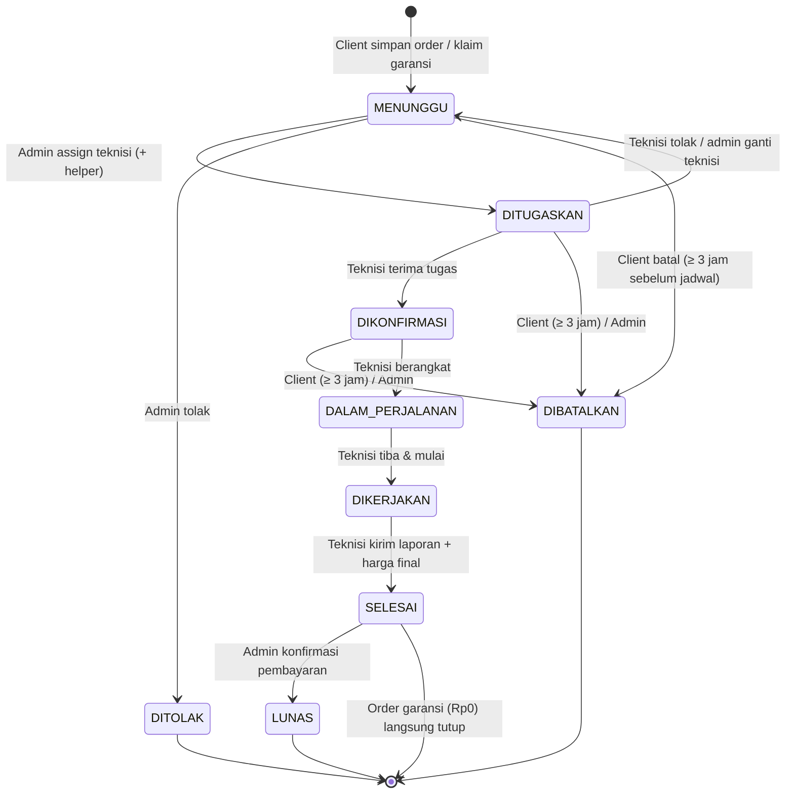

| Status | Siapa yang mengubah | Keterangan |
|---|---|---|
| MENUNGGU | Sistem | Order baru / klaim garansi, menunggu admin |
| DITUGASKAN | Admin | Teknisi (+ helper) sudah dipilih |
| DIKONFIRMASI | Teknisi | Teknisi menerima tugas |
| DALAM_PERJALANAN | Teknisi | Menuju lokasi client |
| DIKERJAKAN | Teknisi | Pekerjaan berlangsung |
| SELESAI | Teknisi | Laporan terkirim; masa garansi mulai dihitung |
| LUNAS | Admin | Pembayaran diterima |
| DITOLAK / DIBATALKAN | Admin / Client | Order berakhir tanpa dikerjakan |

> Ulasan boleh diberikan sejak status **SELESAI**.

---

## 4. Flowchart Client

### 4.1 Login & Alamat

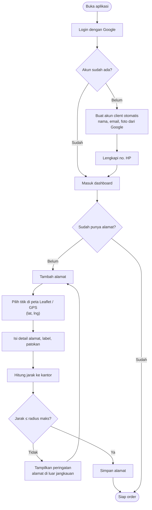

### 4.2 Membuat Order (Multi Unit)

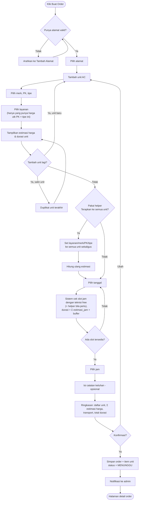

### 4.3 Pantau Order, Batal, Laporan & Ulasan

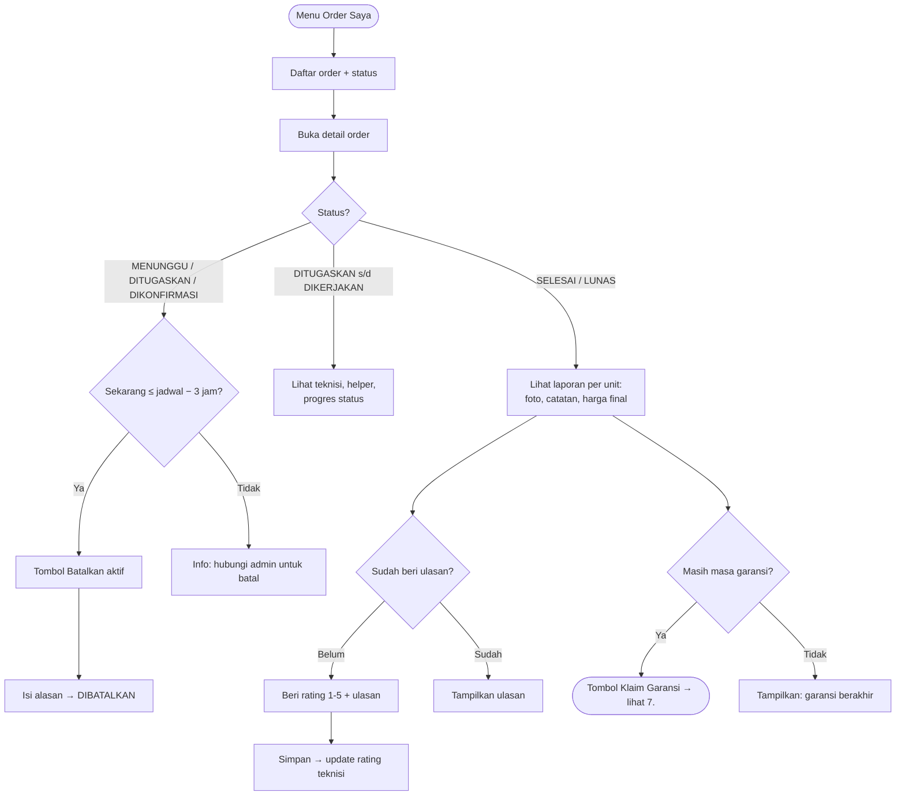

---

## 5. Flowchart Admin

### 5.1 Terima & Assign Order

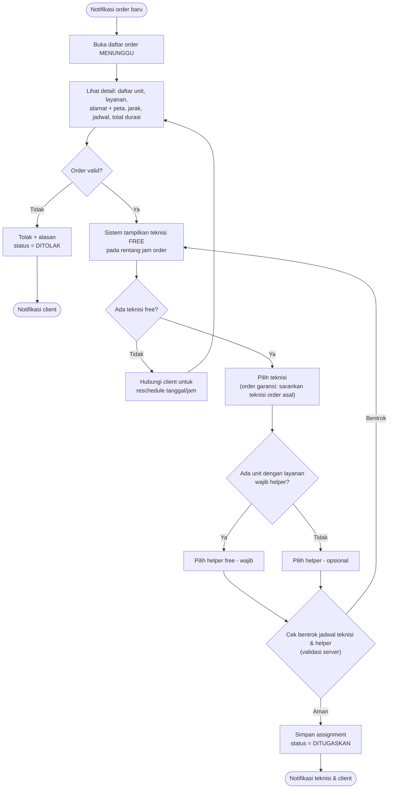

### 5.2 Konfirmasi Pembayaran

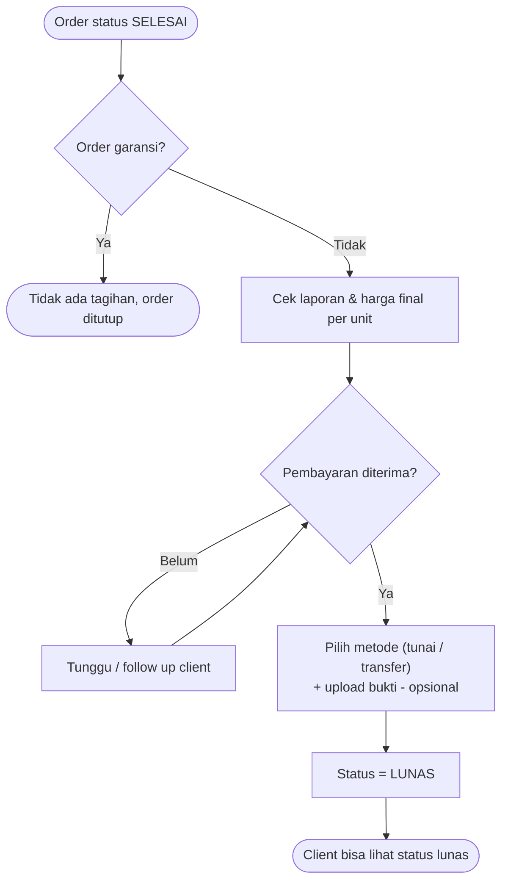

### 5.3 Input Matriks Harga Layanan (dengan helper)

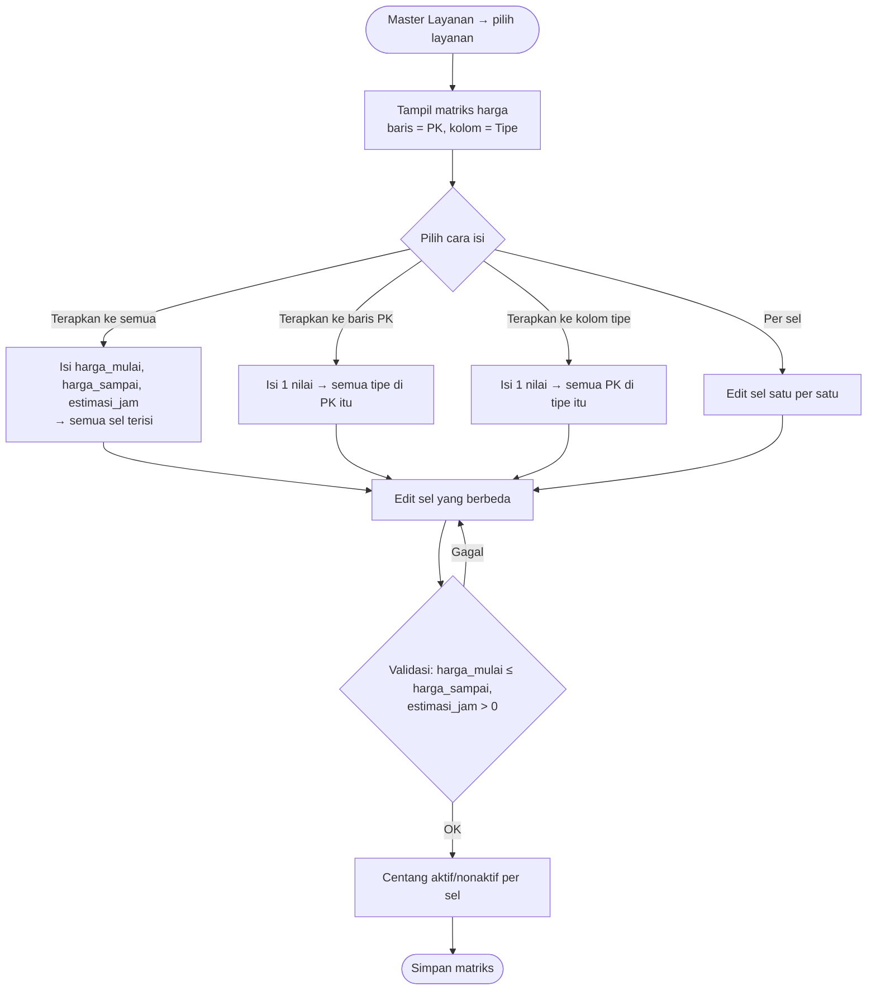

Contoh matriks **Cuci AC** (harga dalam ribuan Rp · jam):

| PK \ Tipe | Standar | Low Watt | Inverter |
|---|---|---|---|
| 0.5 – 1 PK | 75–90 · 1 | 75–90 · 1 | 90–110 · 1 |
| 1.5 PK | 90–110 · 1 | 90–110 · 1 | 110–130 · 1.5 |
| 2 PK | 110–130 · 1.5 | 110–130 · 1.5 | 130–160 · 1.5 |

### 5.4 Master Data & Pengaturan

- **Company Profile** — nama, alamat, titik koordinat (pilih di peta Leaflet), jam operasional
- **Pengaturan** — radius gratis, radius maks, tarif/km, buffer perjalanan, **batas pembatalan (default 3 jam)**, **masa garansi default (7 hari)**
- **Layanan** — nama, deskripsi, wajib helper (ya/tidak), garansi hari (kosong = pakai default), aktif, **matriks harga PK × Tipe**
- **Merk AC** — Daikin, Panasonic, LG, Sharp, Gree, dll.
- **PK AC** — 0.5, 0.75, 1, 1.5, 2, 2.5 …
- **Tipe AC** — Inverter, Low Watt, Standar
- **Teknisi** — nama, no. HP, foto, akun login, aktif, hari cuti
- **Helper** — nama, no. HP, aktif, hari cuti (tanpa akun login)
- **Client** — lihat daftar client & alamatnya (read-only / nonaktifkan)

---

## 6. Flowchart Teknisi

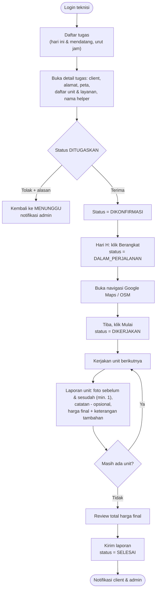

---

## 7. Flowchart Klaim Garansi

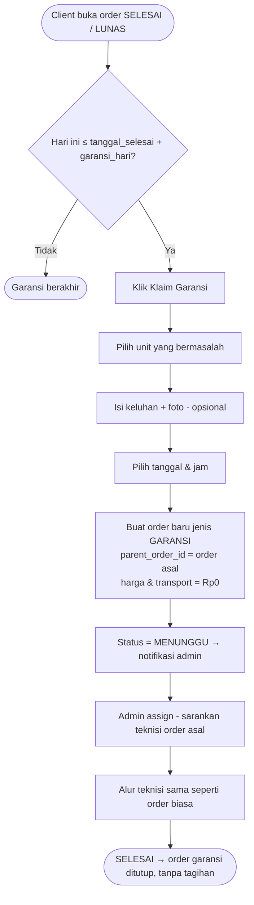

> Jika saat pengecekan ternyata kerusakan **bukan** tanggung jawab garansi, teknisi bisa mengisi harga final > 0 dengan keterangan, dan order diperlakukan seperti order biasa (butuh konfirmasi LUNAS).

---

## 8. Alur End-to-End (Sequence)

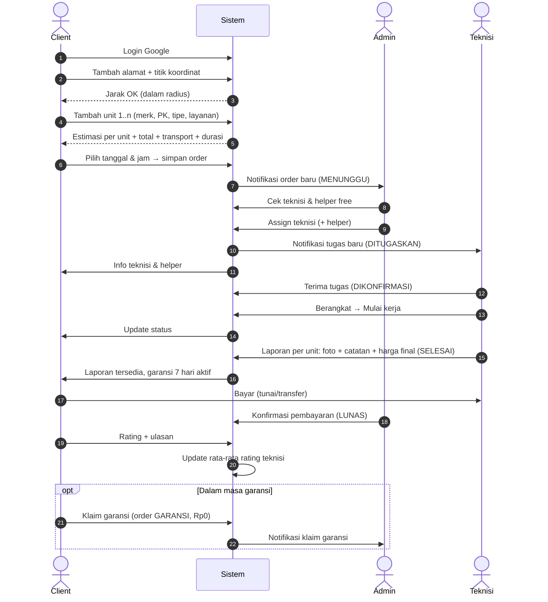

---

## 9. Logika Cek Jadwal Bentrok

Dipakai untuk teknisi **dan** helper, di dua tempat: (1) menampilkan slot jam ke client, (2) validasi saat admin assign.

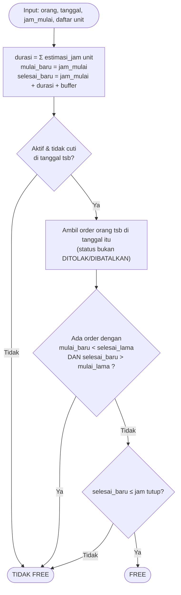

Contoh (buffer 30 menit):

| Order | Isi | Jam | Rentang terkunci |
|---|---|---|---|
| #1 | 2 unit cuci AC (2 × 1 jam) | 09:00 | 09:00 – 11:30 |
| #2 | 1 unit perbaikan (2 jam) | 11:30 | 11:30 – 14:00 ✅ tidak bentrok |
| #3 | 1 unit cuci AC (1 jam) | 13:00 | ❌ bentrok dengan #2 |

Contoh query MySQL (cek bentrok teknisi):

```sql
SELECT COUNT(*) FROM orders
WHERE technician_id = :tech_id
  AND schedule_date = :date
  AND status NOT IN ('DITOLAK','DIBATALKAN')
  AND start_time < :new_end
  AND end_time   > :new_start;
-- > 0 berarti bentrok
```

---

## 10. Perhitungan Jarak & Biaya Transport

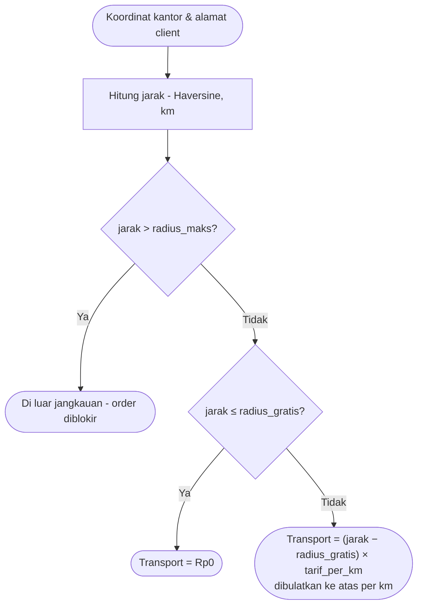

Contoh order 2 unit:

| Unit | Layanan | Estimasi |
|---|---|---|
| Daikin 1 PK Standar | Cuci AC | Rp75.000 – Rp90.000 |
| LG 1.5 PK Inverter | Cuci AC | Rp110.000 – Rp130.000 |
| Transport (12 km, gratis 5 km, Rp3.000/km) | | Rp21.000 |
| **Total estimasi** | | **Rp206.000 – Rp241.000** |

> Harga, estimasi jam, jarak, dan transport di-**snapshot** ke order/item saat order dibuat, supaya tidak berubah jika master harga/pengaturan diubah kemudian.

---

## 11. Struktur Data (ERD — MySQL)

> **Versi lengkap & terbaru ada di [ERD.md](ERD.md)** (kamus data, index, query kunci). Diagram di bawah hanya ringkasan awal.

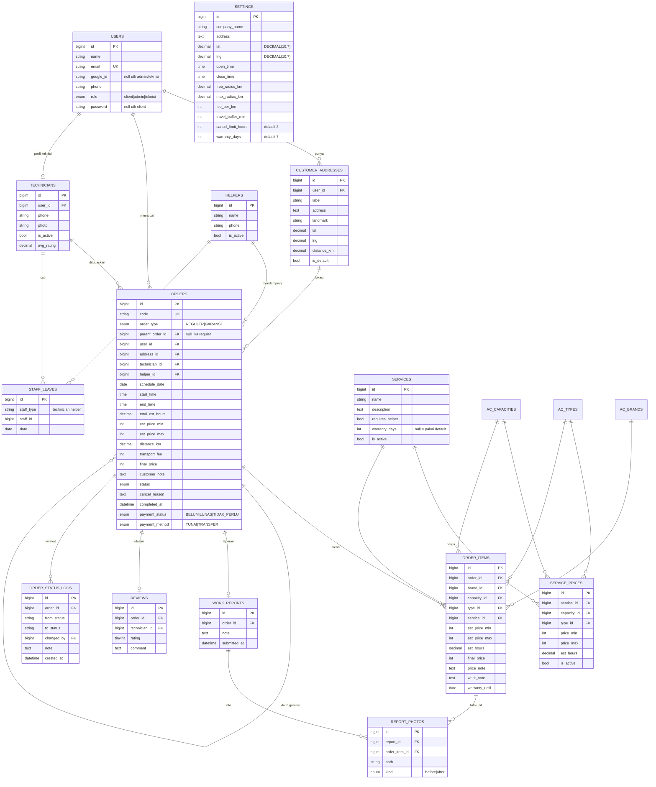

---

## 12. Catatan Implementasi Laravel 12

| Kebutuhan | Rekomendasi |
|---|---|
| Login Google (client) | `laravel/socialite` |
| Login admin & teknisi | Auth bawaan Laravel (session), guard sama dengan kolom `role` |
| Hak akses | Middleware `role:client/admin/teknisi` + Policy (mis. teknisi hanya lihat order miliknya) |
| Peta & titik koordinat | Leaflet + tile OpenStreetMap; marker bisa di-drag; tombol "Lokasi saya" (Geolocation API) |
| Cari alamat di peta | Nominatim (OSM) geocoding — perhatikan batas 1 request/detik |
| Hitung jarak | Fungsi Haversine di PHP (service class) — hasil disimpan di `customer_addresses.distance_km` |
| Upload foto laporan | Storage `public` disk + kompres/resize (mis. `intervention/image`) |
| Status order | Enum PHP 8.1 (`OrderStatus`) + satu service `OrderStatusService` yang memvalidasi transisi & menulis `order_status_logs` |
| Cek bentrok | Service `ScheduleService::isFree($staff, $date, $start, $end)` + DB transaction/lock saat assign |
| Batas batal & garansi | Ambil dari tabel `settings` (cache), cek di Policy/Service |
| Notifikasi | Laravel Notifications — channel `database` (in-app) + `mail` (email, via queue) |
| Frontend | Laravel Blade + komponen Blade; interaktivitas ringan dengan Alpine.js; Tailwind CSS |
| Interface teknisi | Mobile-first (responsif); bisa dijadikan PWA nanti |

---

## 13. Daftar Halaman per Interface

**Client**
- Login (Google)
- Dashboard (order aktif + tombol Buat Order)
- Alamat Saya (list, tambah/edit dengan peta Leaflet, set default)
- Buat Order (wizard: alamat → unit AC [tambah / salin / terapkan ke semua] → jadwal → ringkasan)
- Order Saya (list + filter status)
- Detail Order (timeline status, teknisi & helper, laporan per unit, ulasan, batal, klaim garansi)
- Profil

**Admin**
- Dashboard (order baru, order hari ini, klaim garansi, pendapatan, rating rata-rata)
- Order (list + filter status/tanggal/jenis, detail, assign teknisi + helper, tolak, batal, konfirmasi bayar)
- Jadwal (timeline per teknisi & helper per hari)
- Master: Layanan (+ matriks harga), Merk, PK, Tipe AC, Teknisi, Helper, Client
- Company Profile & Pengaturan (koordinat, radius, tarif, jam operasional, buffer, batas batal, garansi)
- Ulasan (daftar rating & ulasan)

**Teknisi** (mobile-first)
- Login
- Tugas Hari Ini / Mendatang
- Detail Tugas (Terima/Tolak, Berangkat, Mulai, navigasi Maps)
- Form Laporan per unit (foto, catatan, harga final)
- Riwayat Tugas & Rating Saya

---

## 14. Notifikasi (disarankan)

| Event | Penerima | Channel |
|---|---|---|
| Order baru / klaim garansi | Admin | In-app + email |
| Teknisi ditugaskan | Teknisi, Client | In-app + email |
| Teknisi tolak tugas | Admin | In-app + email |
| Teknisi berangkat / mulai | Client | In-app + email |
| Laporan selesai | Client, Admin | In-app + email |
| Order ditolak / dibatalkan | Client / Admin / Teknisi | In-app + email |
| Pengingat H-1 jadwal | Client, Teknisi | Email (scheduler) |

---

## 15. Keputusan yang Sudah Ditetapkan

| # | Topik | Keputusan |
|---|---|---|
| 1 | Unit per order | Multi unit dalam 1 order |
| 2 | Harga | Berbeda per Layanan × PK × Tipe, dengan helper input "Terapkan ke semua / baris / kolom" |
| 3 | Pembatalan client | Paling lambat 3 jam sebelum jadwal (bisa diatur admin) |
| 4 | Tim | 1 teknisi (pakai aplikasi) + 1 helper (tanpa aplikasi) |
| 5 | Garansi | 7 hari, bisa diatur admin (global & per layanan) |
| 6 | Stack | Laravel 12 (Blade) · MySQL · Leaflet |
| 7 | Notifikasi | In-app + email |

**Berikutnya:** sample UI (mockup) sebelum mulai coding.
